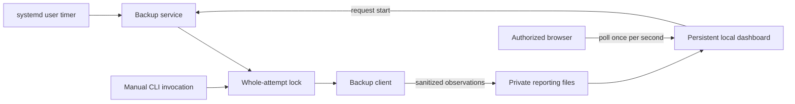

# Local client dashboard

Accepted design for [issue #32](https://github.com/FlorisDeVries/stowhaven/issues/32). All 31 interview decisions and the final shared understanding have been confirmed. This document describes intended behavior, not the current implementation. Dashboard implementation is a separate task.

Domain terms are defined in the root [glossary](../../GLOSSARY.md). Architectural rationale is recorded in [ADR 0001](../adr/0001-independent-local-dashboard.md) and [ADR 0002](../adr/0002-client-owned-local-reporting.md).

## Confirmed decisions

- The dashboard remains available independently of individual backup processes, including while idle and after a backup process crashes.
- Installation is opt-in, with instructions for enabling the dashboard alongside the existing systemd user service and timer.
- Backup freshness uses an explicitly configured maximum backup age. Scheduler activity alone does not establish freshness. Without that setting, display the age without assigning a healthy or overdue judgment.
- Preserve the existing short-lived Linux systemd backup service and timer. Add a separate persistent dashboard service that observes progress and requests starts; stopping it does not stop a backup. See [the architecture decision](../adr/0001-independent-local-dashboard.md).
- Prevent overlapping backup attempts across CLI, timer, and dashboard entry points for each backup state database. A duplicate start reports that an attempt is already running and does not queue another attempt.
- Only a clean successful backup or a clean no-changes check refreshes freshness. Completed-with-errors, pending, and failed outcomes do not. Existing timestamps with uncertain outcomes cannot establish clean history.
- When a client exits with pending server work, show pending server completion with the client inactive. The next scheduled or manual attempt reconciles it; the dashboard does not independently poll the cloud or perform local completion.
- Represent scanning and uploading as simultaneous activities when they overlap. Follow with server processing and local completion; percentages require known totals.
- Persist the latest 100 attempt summaries and bounded actionable diagnostics across restarts. Indicate truncated diagnostics and retain the existing log rotation policy.
- A backup attempt is one client invocation; a backup run is server-backed work that can span attempts. Persist their relationship and each run's outcome so later results do not erase earlier degradation.
- Measure freshness from the start of the scan that established a clean result. Store completion time separately; delayed server confirmation does not make earlier observations newly examined.
- The backup client records progress and history even while the optional dashboard service is stopped. It owns a versioned, sanitized local reporting contract. Coalesce live updates to at most one per second and emit heartbeats during quiet operations.
- Observations become stale after 15 seconds without a heartbeat. Silence alone does not establish process exit. Label an attempt interrupted only after confirming exit without a final result; the execution lock remains authoritative for duplicate-start prevention.
- Authorize private status/log reads as well as control requests, including protection from other local users. Provide an open-dashboard command that authorizes the browser without a separate password. Validate browser origins and hosts and bind only to loopback.
- Identify diagnostic files by target name and relative path. Remove secrets before persistence; retain at most 100 actionable diagnostic entries per attempt alongside complete category counts and an explicit truncation indicator. Recent logs use a bounded, redacted view.
- An empty first scan can be a clean check. Show that no backup has been created yet and distinguish the last clean check from the last completed backup.
- If an attempt reconciles an older degraded run and then completes a new clean run, summarize it as completed with errors and retain both run results. The newer clean run may independently establish freshness. An aborted attempt is failed; unfinished server work remains pending with earlier errors visible.
- Present freshness, the latest attempt outcome, and the existence of a completed server backup as separate indicators. A recent clean check can coexist with a failed latest attempt; an empty first scan prominently shows that no backup has been created yet.
- Retain the original scan time and skipped/deferred/failed-file evidence with pending work until reconciliation completes. Missing evidence in older pending records means unknown cleanliness, not an inferred clean outcome.
- The first dashboard manages one configured backup state database and all its targets. Recognize state-path aliases for overlap prevention. Multiple profiles and separate databases sharing a server device identity are outside the initially supported configuration.
- Dashboard starts use the existing systemd user service and confirm that execution started. Missing units, unavailable user sessions, and start failures are actionable errors; there is no silent fallback to a different execution mechanism.
- Failure of optional dashboard reporting does not stop backup execution or weaken its recovery guarantees. Report observation failures where possible and show stale/unavailable status with the last verified evidence.
- Browser authorization expires on dashboard-service restart or after 12 hours of inactivity. Reauthorize through the open-dashboard command; authorization expiry does not stop backups.
- Store the portable reporting contract in private local JSON files, separate from credential-bearing backup state. Replace snapshots atomically and bound per-attempt history. The authenticated browser polls the dashboard once per second and reconnects to the recorded attempt after reload.
- Unsupported reporting schemas produce an explicit compatibility error and upgrade guidance. Preserve files, mark reporting unavailable, and interpret only supported schemas.
- Retain minimal pending-run evidence and the latest clean-result evidence separately from rolling history. Pruning finished historical detail cannot weaken recovery or remove the freshness baseline.
- Read actual systemd timer state for enabled status and next activation. Distinguish a disabled timer from unavailable scheduler information. Show unknown next-run values honestly instead of predicting them from configuration.
- When targets or exclusion rules change, preserve history but invalidate its freshness judgment for the current selection. Show configuration changed and no clean result for this selection until a clean attempt covers it.
- The first release supports Linux systemd integration with a portable reporting contract. Windows/macOS dashboard integration and the alternative resident scheduler are deferred. Detect incompatible scheduling configuration and explain the correction.
- Disabling or removing the dashboard stops/removes only the companion service. Preserve backup scheduling, pending work, and recorded history. Document compatible upgrade and rollback procedures, including older readers encountering newer reporting data.
- Implementation requires real competing-process lock tests, a Linux systemd smoke check, focused automated coverage, and the repository verification command. Installation, troubleshooting, and rollback instructions are required.

## Issue requirements carried forward

- Show idle activity, API waking, scanning, uploading, server processing, and local completion as applicable. Show scanned, unchanged, uploaded, skipped, failed, and deferred file counts, uploaded bytes, current target, elapsed time, useful transfer rates, and warnings.
- Keep no changes, pending, succeeded, completed with errors, and failed outcomes visibly distinct. Uploaded files alone do not establish success; server completion and local completion are required.
- Distinguish current activity, the last recorded snapshot, and stale/unavailable observations after exits, restarts, or reporting failures. API unavailability and failed commits remain visible without presenting old observations as current activity.
- Never expose credentials, SAS URLs, recovery material, or raw credential-bearing backup state through reporting or the UI.
- A tray icon, server administration, and commit-recovery controls remain outside this release.

## Interpretation of evidence

Freshness, the last clean check, and the last completed server backup are distinct evidence. Store original scan time and completion time separately. A scan traverses changing files; a clean result does not imply a point-in-time filesystem snapshot or a restore test. Missing or uncertain evidence cannot establish cleanliness, including when optional reporting has failed.

## Implementation verification plan

These checks are requirements for future implementation; this design change does not implement or execute them.

- Outcomes and health: all five outcomes; upload completion versus server/local completion; clean/degraded checks; empty first scan; resumed degraded run followed by a new clean run; persisted pending evidence; unknown legacy evidence; scan-age timestamps; configuration changes; and separate freshness/latest-attempt indicators.
- Observations and storage: overlapping activities; update coalescing and quiet-operation heartbeats; page reconnect; stale versus confirmed interruption; reporting failure; interrupted atomic writes; schema compatibility; history pruning; and retained pending/freshness evidence.
- Real competing-process locks: CLI/timer/dashboard races, path aliases sharing state, duplicate starts without queuing, crash release, and restart recovery.
- Access and diagnostics: authorization for private reads and controls, origin/host validation, other-local-user access, session expiry/restart, bounded diagnostics/logs, and secret redaction before persistence and display.
- Linux systemd smoke check: opt-in installation, idle access, a real backup through all activities, manual/timer overlap, pending exit/reconciliation, process and companion restart, actual timer-state reporting, unavailable user sessions, and incompatible scheduling configuration.
- Run `bash scripts/verify.sh` and document Linux smoke-check results. Add installation, opening, troubleshooting, upgrade, and rollback instructions.

## Disable, upgrade, and rollback plan

- Verify that disabling/removing the companion preserves the backup service/timer, pending state, and history, including during an active backup.
- Document compatibility between client, companion, and reporting schema versions. Older readers preserve unsupported newer data and present actionable compatibility guidance.
- Verify that disabling/reinstalling the dashboard does not prevent a pending run from completing on a subsequent backup attempt.
- These are operational requirements for implementation. This documentation changes no deployed service, client binary, backup data, or schema.
